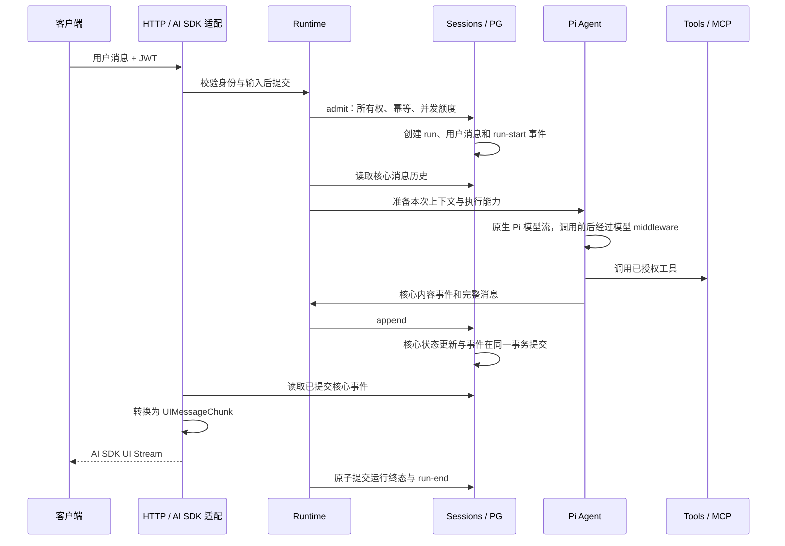

# 架构设计

本文用于理解和修改模块边界、执行链、运行状态与数据一致性。客户端可见行为见[客户端接入](api/README.md)，环境操作见[生产部署](../deploy/production/README.md)。

## 系统边界

业务后端拥有用户、票根、权益和核销事实，并对业务工具访问作最终授权。AI 后端验证调用身份，管理会话与执行，调用外部模型和工具，持久化结果及输出事件。

backend 是唯一生产进程。frontend 是开发工作台；eval 是通过 HTTP 调用服务的独立命令。PG、身份签发系统、模型、MCP 服务和 Langfuse 都是外部依赖。配置了依赖不等于已经完成联调。

## 模块归属

| 模块                                   | 职责                                                                          |
| -------------------------------------- | ----------------------------------------------------------------------------- |
| `apps/backend`                         | 产品 Prompt、认证、HTTP、配置与组装；`http/ai-sdk.ts` 是对外消息协议边界      |
| `packages/harness`                     | 执行器、消息、事件、会话、工具与模型契约；Prompt 渲染与来源；核心消息状态规则 |
| `packages/runtime`                     | 接纳、执行隔离、middleware、预算、超时、取消与关闭                            |
| `packages/flow`、`packages/logging`    | 执行策略、日志配置与异步作用域                                                |
| `plugins/pi`                           | Pi 原生循环和模型接入，`messages.ts` 处理核心消息与 Pi 消息转换               |
| `plugins/sessions-pg`                  | 所有权、幂等、并发额度、事务、核心消息及事件读写、schema 与 migrations        |
| `plugins/context`                      | 历史选择、上下文与摘要策略                                                    |
| `plugins/tools`、`plugins/mcp`         | 工具授权、参数校验、执行和远端身份委托                                        |
| `plugins/prompts`、`plugins/telemetry` | Prompt 来源解析与运行快照；观测契约的 Langfuse 实现、内容处理与导出生命周期   |

模型连接和凭证由 `backend/config.ts` 读取、校验后注入；`backend/config.yaml` 拥有模型选择、上下文压缩和执行预算。[百炼 Provider](../plugins/pi/src/model/providers/bailian.ts) 定义端点、认证和模型目录；Pi 模型适配器通过实例内的 `createModels()` 选择模型并调用服务。对话和摘要共用 runtime 模型 middleware，harness 使用独立于 Pi 的模型契约。具体模型、能力和配置见[模型与执行策略](integrations.md#模型与执行策略)。

Cordis 负责资源生命周期和组装。运行逻辑通过显式契约使用能力，核心不依赖应用或插件。后端的 AI SDK 消息依赖只位于 HTTP 边界；前端直接消费 SDK 协议。PG 不定义展示规则，Pi 不写数据库或 HTTP 响应。

Prompt 定义和默认模板归使用模块；[harness/prompts.ts](../packages/harness/src/prompts.ts) 提供模板校验、渲染、组合与来源契约，[prompts 插件](../plugins/prompts/src/index.ts) 负责本地或远程来源解析与运行快照。runtime 在每次运行开始时解析快照，使用模块调用 `renderPrompt` 渲染；内容与来源一起经过 middleware，模型边界校验内容指纹，Pi 在协议转换时取出文本。配置方式见 [Prompt 管理与 Langfuse](integrations.md#prompt-管理与-langfuse)。

内置工具归 `plugins/tools/src/builtins`，各工具集中定义名称、展示名称、描述、参数、授权和执行逻辑。tools 插件接收 sessions 能力，组装会话检索并合并显式定义及外部工具来源。检索通过 `harness/sessions` 契约访问存储，由 PG 检查所有权、运行位置和查询范围。具体语义见[当前会话检索](integrations.md#当前会话检索)。

## Harness 内部结构

Harness 定义能力契约和与存储实现无关的会话状态规则。目录按职责组织；只有包含多个组成的 sessions 和 execution 展开为目录。

```text
packages/harness/src/
├── index.ts                 公共导出
├── scope.ts                 Actor、RunScope、运行预算
├── messages.ts              模型消息与内部来源信息
├── events.ts                Agent 事件、会话事件、运行状态
├── models.ts                ModelInput、模型调用与结果
├── tools.ts                 工具定义、调用与拦截契约
├── prompts.ts               模块定义、模板快照、渲染与来源契约
├── context.ts               历史选择、摘要存储与上下文估算
├── sessions/
│   ├── index.ts             会话服务、运行、存储消息与历史轮次
│   └── state.ts             核心事件驱动的消息状态更新
├── execution/
│   ├── index.ts             AgentExecutor、AgentExecution 与限制
│   └── middleware.ts        执行钩子与生命周期观察
├── errors.ts                服务错误码与错误类型
└── telemetry.ts             观测作用域、数据与结果契约
```

`scope`、`messages` 和 `errors` 是基础定义，不依赖执行能力。events 依赖消息；sessions 依赖身份、消息和事件；models 与 tools 不依赖 execution。context 使用模型输入和历史轮次，execution 组合这些能力。telemetry 使用消息值与模型 usage 类型，独立于执行器和观测 SDK。类型导入也遵循此方向。

`RunScope` 只传递可信身份、运行标识、取消信号和预算。runtime 创建每次运行的作用域和历史快照，将它们分别交给 middleware；`AgentExecution` 提供作用域、历史和受控调用。Tools 只接收自身定义的调用拦截函数，无需了解整个 AgentExecution。

`StoredMessage`、`HistoryTurn` 属于 sessions，`AgentMessage` 只描述消息内容，`ModelInput` 描述一次模型请求的输入。PG 通过 `sessions/state` 应用消息规则，事务仍由 PG 实现负责；核心规则不依赖 Drizzle。服务通过 `ServiceError` 报告错误码，HTTP 在 `http/errors.ts` 将错误码映射为响应状态。

## 一条消息的读写路径



查询会话时，HTTP 将核心消息按 run 聚合为用户消息和 assistant 展示消息。工具输入在完整消息提交后展示，快照采用相同顺序；核心消息仍保留模型原始内容顺序。模型续跑直接读取核心消息，包含 assistant/tool 的有序交互，不从 UI 快照反推上下文。引擎私有来源与回放信息保存在核心消息的内部元数据中，HTTP 显式选择展示字段，不将这些元数据透传。

每次订阅从 run 起点读取核心事件，HTTP 用本次订阅自己的状态生成 SDK 事件。内容片段 ID 根据 run、assistant 序号和内容序号稳定生成，快照与流输出一致。整轮重放不依赖内存中的原订阅，不公开部分游标续传。客户端先替换对应消息，再接收重放内容。

重复请求命中已有 run 时不重复执行。客户端断连只结束订阅；执行、工具会话与 AbortController 均按 run 隔离。关闭时停止接纳、等待事务、取消并等待运行收尾，然后关闭 HTTP 和插件资源。

## 前端工具展示名称

工具定义中的 `name` 用于模型调用、执行匹配和观测，`description` 说明模型可用的能力，`displayName` 提供可选的前端标题。例如当前会话检索的标识是 `search_current_session`，标题是“检索当前会话”。

tools 创建 `ToolSession` 时规范化标题：去除首尾空白，接受 1–80 个 Unicode 码点，排除控制、格式和行段分隔字符；不合格的值省略。内置工具和外部 ToolSource 使用同一规则。

```text
工具定义（name、displayName）
  → 本次 ToolSession 的定义快照
  → runtime 按工具名补齐 assistant 消息中的 tool-call.displayName
  → sessions.append：核心消息和对应事件同事务提交
  → HTTP：从保存的调用记录投影 toolMetadata.displayName
  → 前端：显示标题，缺失时显示 toolName
```

runtime 以本次工具定义为标题来源，替换执行器提供的展示值；未知工具不保存标题。标题保存在核心消息与事件的 JSONB 内容中，工具结果通过 callId 关联调用。快照与重放读取调用时保存的标题，工具定义变更不影响已有记录。

Pi 发送给模型的工具定义只有 `name`、`description`、`inputSchema`，模型历史转换忽略展示名称。HTTP 的消息快照与流共用展示投影；工作台以普通文本显示标题，展开后展示原始标识、输入和结果。公开字段与客户端处理方式见[客户端接入](api/README.md#工具展示名称)。

## 数据关系与事务

字段和索引以 [schema](../plugins/sessions-pg/src/schema.ts) 与 [migrations](../plugins/sessions-pg/migrations) 为准。

| 数据                     | 用途                                                                      |
| ------------------------ | ------------------------------------------------------------------------- |
| `chat_sessions`          | 所有者、标题、下一个运行位置                                              |
| `chat_runs`              | 请求幂等、用户消息引用、运行位置、状态与事件序号                          |
| `chat_messages`          | 唯一的核心消息记录，按 run/ordinal 排序；保存部分内容、完整消息与中断状态 |
| `chat_run_events`        | 按 run/sequence 排序的核心执行事件，用于输出重放                          |
| `chat_context_summaries` | 已完成历史的摘要、覆盖位置、策略和修订版本                                |

一轮可以包含多条 assistant 与 tool 消息。`chat_messages` 的消息用于查询及模型上下文，事件记录用于重放；两种读取形态来自同一次提交。数据库不保存 SDK parts/chunks，也不在 run 中另存一份 transcript。

接纳时取得全局接纳锁及会话行锁，校验所有权、幂等、活跃运行与额度。运行位置由会话分配，数据库唯一索引阻止同一会话同时存在两个 running 运行。网络调用不占用数据库事务。

追加时锁定 run，使用 [核心状态规则](../packages/harness/src/sessions/state.ts) 更新受影响消息，再保存核心事件与序号。完整消息必须与已发送的增量内容一致，工具结果必须匹配唯一调用。结束时将未完成消息标为 interrupted；没有结果的外部工具不生成虚构结果，HTTP 展示为结果未确认。所有变化原子提交，失败后停止继续执行工具。

快照使用 repeatable-read 取得一致视图。上下文读取有效摘要之后的完成运行及当前输入；没有摘要时读取此前完成历史。失败、取消及中断的旧运行不进入完成历史，原始消息仍可查询。

## 状态与恢复

| 状态          | 进入条件                                      |
| ------------- | --------------------------------------------- |
| `running`     | 接纳事务提交                                  |
| `completed`   | Agent 正常结束并成功写入终态                  |
| `cancelled`   | 显式取消或正常关闭中止运行                    |
| `failed`      | 执行失败、超时或执行预算异常导致运行结束      |
| `interrupted` | 新实例启动时发现上一个实例遗留的 running 运行 |

工具错误可能作为工具结果反馈给 Agent，由后续模型步骤处理，不意味着整次运行必然失败。运行终态持久化失败时，runtime 标记自身不健康、拒绝新运行；不能把内存中的完成意图当作已提交状态。

运行超时采用协作取消：达到 `runtime.timeoutMs` 后发出取消信号，等待执行和资源清理结束，再提交运行终态。模型、工具与 middleware 必须响应取消信号；该配置不是强制返回的时间上限。进程关闭另有整体退出期限，见[生产部署](../deploy/production/README.md)。

当前是单执行实例。PG 连接级 advisory lock 阻止第二个执行实例启动；持锁连接丢失会结束进程。启动恢复把遗留 running 运行标记为 interrupted，不自动重做模型或工具调用，以免重复副作用。增加副本前，需要先设计租约、接管和恢复语义。

当前授权模型是用户隔离，没有组织租户、共享会话或管理员跨用户查询。引入这些能力时需明确新的身份和所有权契约。

## 日志与观测

[harness/telemetry.ts](../packages/harness/src/telemetry.ts) 定义 `Telemetry.start/observe` 和 observation 的 `within/update/event/end`。`start` 返回可跨回调使用的句柄，`observe` 管理一次异步操作的开始与结束，`within` 恢复观测作用域。数据投影可通过 `update` 的回调提交，由实现隔离记录异常。

[telemetry 插件](../plugins/telemetry/src/index.ts) 通过 Cordis 管理进程内唯一的 `NodeSDK`，使用 `@langfuse/tracing` 创建观测、`LangfuseSpanProcessor` 导出。应用向 runtime、tools 和 context 显式注入同一个必需的 Telemetry，业务流程直接调用观测能力。应用按 `TELEMETRY_ENABLED` 选择实际插件或 `noopTelemetry`；关闭时不初始化 SDK、不采集内容、不导出数据，原始操作正常执行。独立执行或测试也可显式注入 `noopTelemetry`。[observations.ts](../plugins/telemetry/src/observations.ts) 负责上下文绑定、字段映射和记录失败隔离，SDK 负责序列化与批量发送。

执行结构为 Run → Step → Operation。runtime 管理 Run 与模型调用观测，Pi 在 turn 边界通过 `AgentExecution.startStep` 建立 Step，并在其作用域内准备上下文、调用模型和执行工具。Step 标识由 runId 与 stepIndex 组成；摘要调用位于压缩节点内，不增加 Step 计数。

Step 表达一次循环的分组和时间边界，记录 `stepId`、`stepIndex`、起止时间及本层执行状态。模型输入输出、结束原因和 usage 归 generation，工具参数、结果和错误归工具节点，运行终态归 Run。Step 通过父子关系组织这些操作，不复制正文、工具统计或费用，也不生成额外的步骤总结。工具失败被循环处理后可以继续执行，子节点失败不自动等于 Step 或 Run 失败。

```text
agent.run
├─ agent.step (stepIndex=1)
│  ├─ context.compact
│  │  └─ model.generate (purpose=compaction)
│  ├─ model.generate (purpose=conversation)
│  └─ search_current_session (tool，使用实际工具名)
├─ agent.step (stepIndex=2)
│  └─ model.generate
└─ context.save
```

Run 包含执行及终态提交处理，记录当前用户问题和已提交的助手文本。模型观测包住最终请求校验、额度限制之后的实际调用，返回 usage、首个内容时间和结束原因。tools 在完整的参数校验、授权、执行及输出校验边界记录工具调用；context 记录压缩触发、前后估算、丢弃数量、有损回退及摘要保存。middleware 在相应作用域内执行，其策略逻辑与观测记录分别维护。

工具节点以实际工具名作为 observation name，metadata 记录 `toolCallId`、定义中的 `description` 和有效的可选 `displayName`。tools 在创建会话时统一规范展示名称并保存定义快照，模型目录、执行注册表和工具观测使用同一来源。模型调用记录最终提供给模型的工具定义；工具节点说明本次执行的能力。未知工具调用仍记录名称、调用 ID 和失败状态，不补造定义。

观测句柄保存创建时的 OTel context，供脱离原回调栈的操作恢复父子关系。`sessionId` 和 trace metadata 中的 `runId` 向子操作传播；`stepId/stepIndex` 属于 Step metadata，`toolCallId` 属于工具 metadata，子操作通过父子关系关联 Step。[logging](../packages/logging/src/index.ts) 的异步作用域保存运行、步骤和工具关联字段，traceId/spanId 从当前 OTel span 读取。业务身份通过显式参数传递。

调用方选择观测名称、模型字段和 metadata，并将输入输出保留为结构化值。插件的 [content.ts](../plugins/telemetry/src/content.ts) 统一控制输入输出采集、凭据字段屏蔽和大小限制；metadata 限于诊断指标、关联标识和工具定义说明，不放调用参数、结果或原始异常。记录和导出失败不替换业务结果，业务回调只执行一次。

观测结果区分 completed、cancelled、timeout、denied、failed，属于诊断分类，运行持久化状态见[状态与恢复](#状态与恢复)。[harness/errors.ts](../packages/harness/src/errors.ts) 统一将执行异常转换为分类和诊断码，观测适配器将结果映射为平台字段。Run 由 runtime 在终态提交处理后的统一出口结束观测；提交失败标记 `RUN_PERSISTENCE_FAILED`，以 `executionStatus` 保留执行结果，并停止接纳新运行。错误只导出诊断码。

应用关闭按 runtime、HTTP、逆序插件的顺序释放资源；每项释放都会尝试，错误在结束时汇总。观测 SDK 的关闭等待有独立期限，失败或超时记入日志。PG 保存消息、运行终态和重放事实；Langfuse 用于诊断，不承担运行恢复。采集配置、usage 口径与平台联调见[外部接入](integrations.md#prompt-管理与-langfuse)，进程退出期限见[生产部署](../deploy/production/README.md)。

## Agent Middleware

Agent Middleware 定义运行、模型和工具调用的扩展点，Pi 原生 hooks 由适配层连接到这些扩展点。应用在 `application.ts` 维护一个有序的 middleware 列表；新增策略只需实现并注册。契约见 [harness/execution/middleware.ts](../packages/harness/src/execution/middleware.ts)，组合实现归 [runtime/middleware.ts](../packages/runtime/src/middleware.ts)。

| Hook            | 语义                                                                |
| --------------- | ------------------------------------------------------------------- |
| `beforeAgent`   | 本次运行开始、首次推理前；等待完成                                  |
| `beforeModel`   | 每次对话模型请求前返回本次上下文，包含工具后的后续请求；不覆盖历史  |
| `wrapModelCall` | 包装一次模型调用并返回该次调用结果；conversation 与 compaction 共用 |
| `afterModel`    | 完整模型流及包装器结束后、工具执行前读取结果；不能改写已输出内容    |
| `wrapToolCall`  | 包装已通过参数和权限校验的工具执行；不能改写调用或重复调用 next     |
| `afterAgent`    | Agent 正常结束后；不代表运行终态已提交，不承担异常清理              |

before 按注册顺序，after 按逆序，wrap 第一项位于最外层。请求和 afterModel 结果采用冻结快照；工具只能缩小范围，不能改写 schema。最终上下文仍由核心校验工具范围、调用与结果配对、模型窗口和预算。实际工具副作用始终经过工具服务授权，缓存返回也不能绕过授权。模型和工具的 next 在一个包装层内最多调用一次；自动重试不属于当前契约。

每个定义的 `create(scope, services)` 为每次运行创建独立实例，实例局部变量保存本次运行状态；共享连接和配置由工厂闭包提供。`services.prompts` 是本次运行的不可变模板快照；middleware 通过定义的 `prompts` 数组声明需求，由组装入口统一收集，无需修改公共加载逻辑。`services.history` 是本次运行的冻结历史快照；`services.models` 已绑定当前运行的身份、预算与 middleware，只在 hooks 中执行模型请求。`dispose` 按逆序在成功、失败、取消及部分初始化失败时执行；所有实例都会尝试释放。

上下文策略与调用次数限制可由同一个 middleware 实现：

```ts
import { composePrompts, inlinePrompt } from "@harness/prompts";

const middleware: AgentMiddleware = {
  name: "request-policy",
  create(scope) {
    let calls = 0;
    return {
      beforeModel(request) {
        return {
          ...request.context,
          system: composePrompts(request.context.system, inlinePrompt("回答保持简洁。")),
        };
      },
      async wrapModelCall(request, next) {
        scope.signal.throwIfAborted();
        if (++calls > 10) throw new Error("本次运行模型调用次数超限");
        return next(request);
      },
    };
  },
};
```

该例中的模型计数包含摘要调用。持久状态通过显式存储服务维护，不把任意 middleware 局部变量自动写入会话。身份由执行作用域提供，模型输入和可转换上下文不能设置 Actor。

定义可提供 `onRunEvent` 观察已提交的 started/finished 事实。通知不阻塞执行、取消或关闭，失败只记录诊断日志；它不提供可靠交付保证。事务、业务审计和必须送达的通知不能依赖此回调。

Pi 内部直接转发原生流；middleware 控制请求与调用，不将流拆成另一套事件再重建。模型结果在调用、资源清理及 afterModel 均成功后才交给 Agent 提交。wrapModelCall 必须返回 next 的同一次结果，不能在流已输出后替换完整回答；一次调用最多执行一次 next。

## 上下文与摘要

context 入口统一组装历史加载与 `context-compaction` middleware，配置 schema 位于 context/config.ts，摘要 Prompt 定义位于 context/prompts.ts。runtime 在加载历史前解析运行级 Prompt 快照，历史加载和摘要生成使用同一份快照计算复用指纹。

上下文压缩是独立的 `context-compaction` middleware。每次推理从 canonical 消息建立请求视图，依次处理历史摘要、近期完整对话及本轮工具结果。摘要作为背景数据发送，不作为新的产品指令；原始核心消息与事件重放保持完整。

Provider 模型定义声明窗口和输出能力，应用配置单次输出额度及整轮 token 预算。当前输入估算使用 UTF-8 字节数加消息开销，包含工具 schema，属于保守估算，不是服务商精确 token 计数。实际 usage（包括摘要）计入运行预算。最终检查在所有请求转换之后执行，必要输入仍无法容纳时明确失败。

摘要分批生成，保留当前用户输入及最近完整交互；工具调用与结果作为整体处理。摘要调用使用 `purpose: compaction`，共用模型执行 middleware，但跳过对话的 beforeModel/afterModel，避免递归压缩。摘要失败时，如果输入仍可容纳则继续；否则按完整旧交互裁剪，并记录诊断。这种有损回退仅用于当前运行，不写入持久摘要；它不能保证保留被裁剪的事实。

可持久化摘要只覆盖已完成运行的位置，在 afterAgent 保存，使用 revision 检查避免旧结果覆盖新结果。当前运行内部工具交互的压缩仅留在运行内；下一次成功续接后才可能成为持久摘要来源。存储校验所有权、完成边界和策略版本；复用指纹由策略版本、摘要模板内容及远程名称/版本共同计算；指纹不一致时从原始历史重建。摘要覆盖的旧消息不会被删除。
