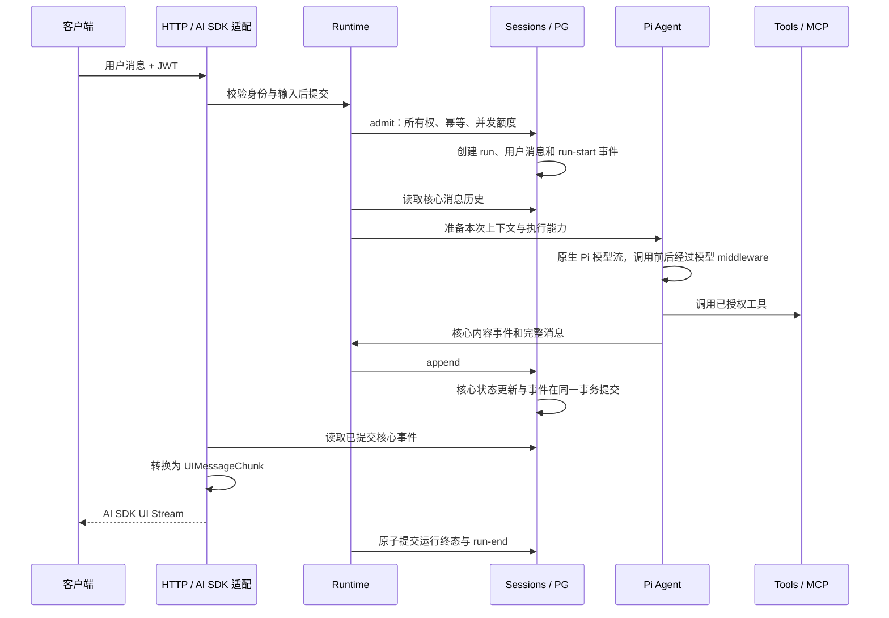

# 架构设计

本文用于理解和修改模块边界、执行链、运行状态与数据一致性。客户端可见行为见[客户端接入](api/README.md)，环境操作见[生产部署](../deploy/production/README.md)。

## 系统边界

业务后端拥有用户、票根、权益和核销事实，并对业务工具访问作最终授权。AI 后端验证调用身份，管理会话与执行，调用外部模型和工具，持久化结果及输出事件。

backend 是唯一生产进程。frontend 是开发工作台；eval 是通过 HTTP 调用服务的独立命令。PG、身份签发系统、模型、MCP 服务和 Langfuse 都是外部依赖。配置了依赖不等于已经完成联调。

## 模块归属

| 模块                                   | 职责                                                                                   |
| -------------------------------------- | -------------------------------------------------------------------------------------- |
| `apps/backend`                         | 产品 Prompt、认证、HTTP、配置与组装；`http/ai-sdk.ts` 是对外消息协议边界               |
| `packages/harness`                     | 执行器、消息、事件、会话、工具与模型调用契约；`sessions/state.ts` 定义核心消息状态变化 |
| `packages/runtime`                     | 接纳、执行隔离、middleware、预算、超时、取消与关闭                                     |
| `packages/flow`、`packages/logging`    | 执行策略、日志配置与异步作用域                                                         |
| `plugins/pi`                           | Pi 原生循环和模型接入，`messages.ts` 处理核心消息与 Pi 消息转换                        |
| `plugins/sessions-pg`                  | 所有权、幂等、并发额度、事务、核心消息及事件读写、schema 与 migrations                 |
| `plugins/context`                      | 历史选择、上下文与摘要策略                                                             |
| `plugins/tools`、`plugins/mcp`         | 工具授权、参数校验、执行和远端身份委托                                                 |
| `plugins/prompts`、`plugins/telemetry` | Prompt 加载、观测和 Langfuse 导出                                                      |

模型连接和凭证由 `backend/config.ts` 读取、校验后注入；`backend/config.yaml` 拥有模型选择、上下文压缩和执行预算。默认通过百炼调用 `deepseek-v4.1-flash`，Provider ID 为 `dashscope`。`plugins/pi/src/model/providers/bailian.ts` 使用 Pi 原生 `createProvider()` 定义端点、显式注入的认证和模型目录；模型窗口、能力上限及兼容参数由该目录维护。应用组装 Provider，Pi 模型适配器使用实例内的 `createModels()` 注册和选择模型，再通过集合调用 `openai-completions`。插件不读取环境变量，不使用全局注册状态。对话和摘要继续经过 runtime 模型 middleware；harness 不依赖 Pi 类型。

Cordis 负责资源生命周期和组装。运行逻辑通过显式契约使用能力，核心不依赖应用或插件。后端的 AI SDK 消息依赖只位于 HTTP 边界；前端直接消费 SDK 协议。PG 不定义展示规则，Pi 不写数据库或 HTTP 响应。

具体内置工具归 `plugins/tools/src/builtins`，成员文件集中定义名称、展示名称、描述、参数、授权和执行逻辑。当前会话检索位于 `search-current-session.ts`；`tools` 插件接收 sessions 能力后组装该内置工具，再合并显式定义和外部工具来源。application 只挂载插件并注入 sessions 等依赖，产品 Prompt 继续归 `backend/agent`。检索契约和结果归现有 `harness/sessions`，PG 负责所有权、运行位置边界、正文过滤与有界查询；工具通过 sessions 契约读取数据，不直接依赖 PG，也不把任意 SQL 或会话标识暴露给模型。具体语义见[当前会话检索](integrations.md#当前会话检索)。

## Harness 内部结构

Harness 定义能力契约和与存储实现无关的会话状态规则。目录按职责组织；只有包含多个组成的 sessions 和 execution 展开为目录。

```text
packages/harness/src/
├── index.ts                 公共导出
├── scope.ts                 Actor、RunScope、运行预算
├── messages.ts              模型消息与内部来源信息
├── events.ts                Agent 事件、会话事件、运行状态
├── models.ts                ModelInput、模型调用与结果
├── tools.ts                 工具定义、调用与拦截契约
├── context.ts               历史选择、摘要存储与上下文估算
├── sessions/
│   ├── index.ts             会话服务、运行、存储消息与历史轮次
│   └── state.ts             核心事件驱动的消息状态更新
├── execution/
│   ├── index.ts             AgentExecutor、AgentExecution 与限制
│   └── middleware.ts        执行钩子与生命周期观察
├── errors.ts                服务错误码与错误类型
└── telemetry.ts             观测契约
```

`scope`、`messages` 和 `errors` 是基础定义，不依赖执行能力。events 依赖消息；sessions 依赖身份、消息和事件；models 与 tools 不依赖 execution。context 使用模型输入和历史轮次，execution 组合这些能力。类型导入也遵循此方向，避免模型、工具与 middleware 互相引用。

`RunScope` 只传递可信身份、运行标识、取消信号和预算。runtime 创建每次运行的作用域和历史快照，将它们分别交给 middleware；`AgentExecution` 提供作用域、历史和受控调用。Tools 只接收自身定义的调用拦截函数，无需了解整个 AgentExecution。

`StoredMessage`、`HistoryTurn` 属于 sessions，`AgentMessage` 只描述消息内容，`ModelInput` 描述一次模型请求的输入。PG 通过 `sessions/state` 应用消息规则，事务仍由 PG 实现负责；核心规则不依赖 Drizzle。服务通过 `ServiceError` 报告错误码，HTTP 在 `http/errors.ts` 将错误码映射为响应状态。

## 一条消息的读写路径



查询会话时，HTTP 将核心消息按 run 聚合为用户消息和 assistant 展示消息。工具输入在完整消息提交后展示，快照采用相同顺序；核心消息仍保留模型原始内容顺序。模型续跑直接读取核心消息，包含 assistant/tool 的有序交互，不从 UI 快照反推上下文。引擎私有来源与回放信息保存在核心消息的内部元数据中，HTTP 显式选择展示字段，不将这些元数据透传。

每次订阅从 run 起点读取核心事件，HTTP 用本次订阅自己的状态生成 SDK 事件。内容片段 ID 根据 run、assistant 序号和内容序号稳定生成，快照与流输出一致。整轮重放不依赖内存中的原订阅，不公开部分游标续传。客户端先替换对应消息，再接收重放内容。

重复请求命中已有 run 时不重复执行。客户端断连只结束订阅；执行、工具会话与 AbortController 均按 run 隔离。关闭时停止接纳、等待事务、取消并等待运行收尾，然后关闭 HTTP 和插件资源。

## 前端工具展示名称

工具的 `name` 是模型调用、执行匹配和 Langfuse 使用的稳定标识。可选 `displayName` 是前端标题，`description` 是给模型的用途与限制说明。当前会话检索定义 `name: "search_current_session"`、`displayName: "检索当前会话"`；两者与工具描述一起归 `plugins/tools/src/builtins/search-current-session.ts`。

`plugins/tools` 在创建本次 `ToolSession` 时整理定义：标题去除首尾空白，允许 1–80 个 Unicode 码点，过滤含控制、格式或行段分隔字符的值。不合格的展示值省略，不影响原有工具注册与执行。没有标题的工具直接回退到标识，不从模型描述推测标题。外部 ToolSource 可通过同一可选字段提供标题。

```text
工具定义（name、displayName）
  → 本次 ToolSession 的定义快照
  → runtime 接收 assistant message 事件，补齐 tool-call.displayName
  → sessions.append：消息和对应事件同事务提交
  → HTTP：快照与 SSE 从已保存的 displayName 投影 toolMetadata
  → 前端：displayName 优先，toolName 兜底
```

`harness/messages` 的 `tool-call` 保存可选 `displayName`，不引入 SDK 类型。runtime 在现有 `onEvent` 提交边界按 `part.name` 查找本次工具定义，复制消息并补充该字段，再调用 `sessions.append`。执行器传入的展示名称会被丢弃，未知工具不补名称。处理不修改原始执行器消息，不更改内容块顺序、callId、name、input 或 provider replay 数据。结果消息通过 callId 关联调用，不重复保存标题。

展示名称与调用事实进入同一个 message 事件，沿用 PG 对消息、事件的原子提交。消息和事件使用现有 JSONB 字段，无新增数据库结构或历史回填。持久化失败仍按原有运行失败规则处理。

快照和 SSE 均读取保存的标题，不重新发现工具或查询全局名称表。工具改名或下线后，已有调用保留当时名称，新调用使用新的定义；旧记录没有标题时回退原始标识。历史文案不会随工具定义更新而改变。所有权校验继续使用已验证身份和既有会话接口。

`ModelInput.tools` 只描述 `name`、`description`、`inputSchema`，Pi 构造模型请求时显式选择这三个字段；模型历史转换也忽略展示名称。Langfuse 的工具 observation 继续使用原始名称，不增加展示元数据或新的 span。

HTTP 适配归 `backend/http/ai-sdk.ts`，快照的动态工具 part 和 SSE 的 `tool-input-available` 共用展示投影，使用 SDK 支持的 `toolMetadata.displayName`。结果或错误按 callId 更新原调用，保留其展示信息。公开字段与兼容规则见[客户端接入](api/README.md#工具展示名称)。

工作台 `MessagePart` 直接从消息元数据计算标题，不维护翻译表或额外展示状态。折叠时显示“检索当前会话 · 已完成”及工具图标，展开时显示原始工具标识、输入、输出或错误；标题以普通 React 文本渲染，不解析 HTML/Markdown。新增工具只需在定义中提供标题。

## 数据关系与事务

字段和索引以 [schema](../plugins/sessions-pg/src/schema.ts) 与 [migrations](../plugins/sessions-pg/migrations) 为准。

| 数据                     | 用途                                                                      |
| ------------------------ | ------------------------------------------------------------------------- |
| `chat_sessions`          | 所有者、标题、下一个运行位置                                              |
| `chat_runs`              | 请求幂等、用户消息引用、运行位置、状态与事件序号                          |
| `chat_messages`          | 唯一的核心消息记录，按 run/ordinal 排序；保存部分内容、完整消息与中断状态 |
| `chat_run_events`        | 按 run/sequence 排序的核心执行事件，用于输出重放                          |
| `chat_context_summaries` | 已完成历史的摘要、覆盖位置、策略和修订版本                                |

一轮可以包含多条 assistant 与 tool 消息。`chat_messages` 的消息用于查询及模型上下文，事件记录用于重放；两种读取形态来自同一次提交。数据库不保存 SDK parts/chunks，也不在 run 中另存一份 transcript。

接纳时取得全局接纳锁及会话行锁，校验所有权、幂等、活跃运行与额度。运行位置由会话分配，数据库唯一索引阻止同一会话同时存在两个 running 运行。网络调用不占用数据库事务。

追加时锁定 run，使用 [核心状态规则](../packages/harness/src/sessions/state.ts) 更新受影响消息，再保存核心事件与序号。完整消息必须与已发送的增量内容一致，工具结果必须匹配唯一调用。结束时将未完成消息标为 interrupted；没有结果的外部工具不生成虚构结果，HTTP 展示为结果未确认。所有变化原子提交，失败后停止继续执行工具。

快照使用 repeatable-read 取得一致视图。上下文读取有效摘要之后的完成运行及当前输入；没有摘要时读取此前完成历史。失败、取消及中断的旧运行不进入完成历史，原始消息仍可查询。

## 状态与恢复

| 状态          | 进入条件                                      |
| ------------- | --------------------------------------------- |
| `running`     | 接纳事务提交                                  |
| `completed`   | Agent 正常结束并成功写入终态                  |
| `cancelled`   | 显式取消或正常关闭中止运行                    |
| `failed`      | 执行失败、超时或执行预算异常导致运行结束      |
| `interrupted` | 新实例启动时发现上一个实例遗留的 running 运行 |

工具错误可能作为工具结果反馈给 Agent，由后续模型步骤处理，不意味着整次运行必然失败。运行终态持久化失败时，runtime 标记自身不健康、拒绝新运行；不能把内存中的完成意图当作已提交状态。

当前是单执行实例。PG 连接级 advisory lock 阻止第二个执行实例启动；持锁连接丢失会结束进程。启动恢复把遗留 running 运行标记为 interrupted，不自动重做模型或工具调用，以免重复副作用。增加副本前，需要先设计租约、接管和恢复语义。

当前授权模型是用户隔离，没有组织租户、共享会话或管理员跨用户查询。引入这些能力时需明确新的身份和所有权契约。

## 日志与观测

执行结构为 Run → Step → Operation。runtime 拥有 Run，Pi 循环在 turn 边界建立 Step；Step 包含本轮上下文准备、模型决策及其触发的工具执行。摘要模型调用属于压缩操作，不增加 Step 计数。Step 身份为 runId 与 stepIndex 的组合，与是否启用 Langfuse 无关。

```text
agent.run
├─ agent.step (stepIndex=1)
│  ├─ context.compact (实际触发压缩时)
│  │  └─ model.generate (purpose=compaction)
│  ├─ model.generate (purpose=conversation)
│  └─ tool.execute
├─ agent.step (stepIndex=2)
│  └─ model.generate
└─ context.save (有历史摘要需要保存时)
```

[观测契约](../packages/harness/src/telemetry.ts) 提供 `start`、`observe` 与 observation 的 `within/update/event/end`。跨回调阶段使用显式句柄，常规异步操作使用 `observe`。Pi 通过 Step 的 `within` 显式绑定模型和工具入口，不依赖事件监听器的异步作用域自动传播。结束幂等，失败和取消时也关闭 Step。

模型实际调用在 runtime 的统一入口记录一次 generation，Pi 适配器只返回模型结果、usage 和首个生成内容的时间。工具入口记录校验、授权、执行及输出处理；工具失败可由 Agent 后续步骤处理，不必使整个 Run 失败。上下文模块拥有压缩原因、前后估算、丢弃范围、摘要版本和有损回退事件。估算注明 UTF-8 字节及额外开销，实际 usage 独立记录。

middleware 的 `create` 接收统一 telemetry；新增已有类型的操作和 metadata 不需修改 runtime 或导出器。例如在 `beforeModel` 内使用 `telemetry.observe({ name: "context.retrieve", type: "retriever", signal: scope.signal }, async observation => ...)`，自动继承当前 Step。只为有独立诊断价值的操作记录 observation，不为每个 hook 自动生成节点。运行结束状态及落库失败由 agent.run 记录。

Telemetry 插件集中映射 Langfuse 字段、限制 metadata 大小、屏蔽凭证字段和导出。每个子节点携带会话、运行、Step（若存在）、环境和发布版本。诊断日志携带相同的关联字段及 trace/span ID；业务身份仍通过显式参数传递。backend 使用 `LANGFUSE_CAPTURE_CONTENT` 控制输入输出记录，开发和测试默认开启、生产默认关闭。Run 使用明确的 user/assistant 消息角色记录问题与已提交回答，generation 与工具分别记录请求和结果；适配器 replay 数据不导出。内容策略仍需按产品要求处理脱敏和采样，metadata 不承担对话正文。

观测记录和导出失败不替换业务结果。状态区分 completed、cancelled、timeout、denied、failed，异常只记录安全错误码，不上传原始异常正文。Run 在终态提交处理后结束；提交失败记录 RUN_PERSISTENCE_FAILED，并保留此前 executionStatus，同时停止接单。关闭时先排空运行，再关闭 exporter。

PG 拥有持久化消息、运行终态与重放事实，Langfuse 不承担恢复或审计数据的唯一存储。外部配置和平台验收边界见[外部接入](integrations.md)。

## Agent Middleware

Agent Middleware 定义运行、模型和工具调用的扩展点，Pi 原生 hooks 由适配层连接到这些扩展点。应用在 `application.ts` 维护一个有序的 middleware 列表；新增策略只需实现并注册。契约见 [harness/execution/middleware.ts](../packages/harness/src/execution/middleware.ts)，组合实现归 [runtime/middleware.ts](../packages/runtime/src/middleware.ts)。

| Hook            | 语义                                                                |
| --------------- | ------------------------------------------------------------------- |
| `beforeAgent`   | 本次运行开始、首次推理前；等待完成                                  |
| `beforeModel`   | 每次对话模型请求前返回本次上下文，包含工具后的后续请求；不覆盖历史  |
| `wrapModelCall` | 包装一次模型调用并返回该次调用结果；conversation 与 compaction 共用 |
| `afterModel`    | 完整模型流及包装器结束后、工具执行前读取结果；不能改写已输出内容    |
| `wrapToolCall`  | 包装已通过参数和权限校验的工具执行；不能改写调用或重复调用 next     |
| `afterAgent`    | Agent 正常结束后；不代表运行终态已提交，不承担异常清理              |

before 按注册顺序，after 按逆序，wrap 第一项位于最外层。请求和 afterModel 结果采用冻结快照；工具只能缩小范围，不能改写 schema。最终上下文仍由核心校验工具范围、调用与结果配对、模型窗口和预算。实际工具副作用始终经过工具服务授权，缓存返回也不能绕过授权。模型和工具的 next 在一个包装层内最多调用一次；自动重试不属于当前契约。

每个定义的 `create(scope, services)` 为每次运行创建独立实例，实例局部变量保存本次运行状态；共享连接和配置由工厂闭包提供。`services.history` 是本次运行的冻结历史快照；`services.models` 已绑定当前运行的身份、预算与 middleware，只在 hooks 中执行模型请求。`dispose` 按逆序在成功、失败、取消及部分初始化失败时执行；所有实例都会尝试释放。

例如，新增一个上下文策略和调用限制不需要修改 Pi：

```ts
const middleware: AgentMiddleware = {
  name: "request-policy",
  create(scope) {
    let calls = 0;
    return {
      beforeModel(request) {
        return { ...request.context, system: request.context.system + "\n回答保持简洁。" };
      },
      async wrapModelCall(request, next) {
        scope.signal.throwIfAborted();
        if (++calls > 10) throw new Error("本次运行模型调用次数超限");
        return next(request);
      },
    };
  },
};
```

该例中的模型计数包含摘要调用。持久状态通过显式存储服务维护，不把任意 middleware 局部变量自动写入会话。身份由执行作用域提供，模型输入和可转换上下文不能设置 Actor。

定义可提供 `onRunEvent` 观察已提交的 started/finished 事实。通知不阻塞执行、取消或关闭，失败只记录诊断日志；它不提供可靠交付保证。事务、业务审计和必须送达的通知不能依赖此回调。

Pi 内部直接转发原生流；middleware 控制请求与调用，不将流拆成另一套事件再重建。模型结果在调用、资源清理及 afterModel 均成功后才交给 Agent 提交。wrapModelCall 必须返回 next 的同一次结果，不能在流已输出后替换完整回答；一次调用最多执行一次 next。

## 上下文与摘要

上下文压缩是独立的 `context-compaction` middleware。每次推理从 canonical 消息建立请求视图，依次处理历史摘要、近期完整对话及本轮工具结果。摘要作为背景数据发送，不作为新的产品指令；原始核心消息与事件重放保持完整。

Provider 模型定义声明窗口和输出能力，应用配置单次输出额度及整轮 token 预算。当前输入估算使用 UTF-8 字节数加消息开销，包含工具 schema，属于保守估算，不是服务商精确 token 计数。实际 usage（包括摘要）计入运行预算。最终检查在所有请求转换之后执行，必要输入仍无法容纳时明确失败。

摘要分批生成，保留当前用户输入及最近完整交互；工具调用与结果作为整体处理。摘要调用使用 `purpose: compaction`，共用模型执行 middleware，但跳过对话的 beforeModel/afterModel，避免递归压缩。摘要失败时，如果输入仍可容纳则继续；否则按完整旧交互裁剪，并记录诊断。这种有损回退仅用于当前运行，不写入持久摘要；它不能保证保留被裁剪的事实。

可持久化摘要只覆盖已完成运行的位置，在 afterAgent 保存，使用 revision 检查避免旧结果覆盖新结果。当前运行内部工具交互的压缩仅留在运行内；下一次成功续接后才可能成为持久摘要来源。存储校验所有权、完成边界和策略版本；策略版本不一致时从原始历史重建。摘要覆盖的旧消息不会被删除。数据库迁移独立执行，HTTP 启动不修改 schema。
